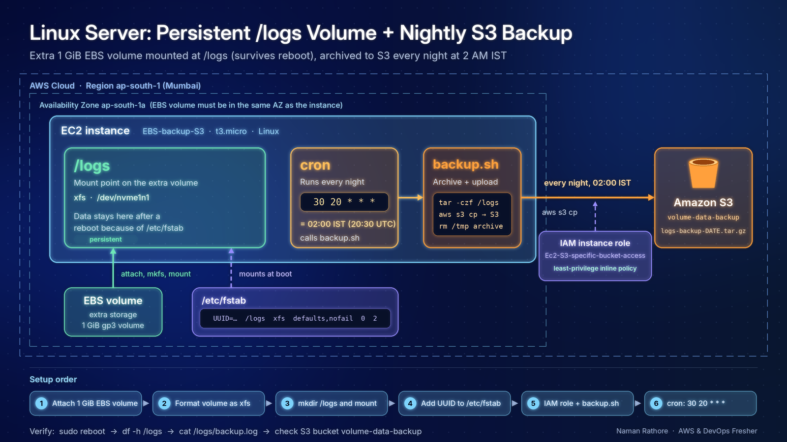

# AWS EBS Volume + Nightly S3 Backup (Linux Server)

> Extra storage on an EC2 Linux server, mounted at `/logs` so it **survives reboots**, with an automated **nightly backup to S3** using a Bash script and cron.



## What this project does

1. Adds an extra **1 GiB gp3 EBS volume** to an EC2 instance
2. Formats it and mounts it at `/logs`
3. Makes the mount **persistent** with `/etc/fstab` (UUID, `nofail`)
4. Runs `backup.sh` every night at **02:00 IST** with cron
5. Archives `/logs` as `logs-backup-YYYY-MM-DD.tar.gz` and uploads it to **S3**
6. Uses an **IAM role** so no access keys are stored on the server

## Repository structure

```
aws-ebs-s3-backup-project/
├── README.md
├── docs/
│   └── architecture.png
├── scripts/
│   └── backup.sh
├── config/
│   ├── crontab.txt
│   ├── fstab-entry.txt
│   └── iam-policy.json
└── evidence/
    └── 01 to 14 screenshots (see the Evidence table)
```

## Resources

| Resource | Value |
|---|---|
| Region / AZ | ap-south-1 (Mumbai) / ap-south-1a |
| EC2 instance | `EBS-backup-S3` (t3.micro, Linux) |
| Extra EBS volume | 1 GiB, gp3, `/dev/nvme1n1`, xfs, same AZ as the instance |
| Mount point | `/logs` |
| S3 bucket | `volume-data-backup` |
| IAM role | `Ec2-S3-specific-bucket-access` (instance profile) |
| Backup script | `/home/ec2-user/backup.sh` |
| Backup log | `/logs/backup.log` |
| Schedule | `30 20 * * *` (server runs in UTC, so this is 02:00 IST) |

## Step-by-step

### 1. Create and attach the volume
EC2 → Volumes → **Create volume** (gp3, 1 GiB, **same AZ as the instance**) → Actions → **Attach volume**.

### 2. Format and mount
```bash
lsblk                                  # find the new disk (on t3 it shows as nvme1n1)
sudo mkfs -t xfs /dev/nvme1n1          # device name from lsblk
sudo mkdir /logs
sudo mount /dev/nvme1n1 /logs
df -h /logs
sudo chown ec2-user:ec2-user /logs
```

### 3. Make the mount survive a reboot
```bash
sudo blkid /dev/nvme1n1                # copy the UUID
echo 'UUID=<your-uuid>  /logs  xfs  defaults,nofail  0  2' | sudo tee -a /etc/fstab
sudo umount /logs && sudo mount -a     # test the fstab entry BEFORE rebooting
df -h /logs
```
- Use the **UUID**, not `/dev/nvme1n1`. Device names can change.
- `nofail` stops a missing volume from blocking the boot.

### 4. Give the server S3 access (IAM role)
Role `Ec2-S3-specific-bucket-access` is attached to the instance, so no access keys are stored on the server. It has one **inline policy** that follows least privilege: only two actions, and only on the backup bucket.
```json
{
  "Version": "2012-10-17",
  "Statement": [
    {
      "Sid": "Statement1",
      "Effect": "Allow",
      "Action": [
        "s3:PutObject",
        "s3:ListBucket"
      ],
      "Resource": [
        "arn:aws:s3:::volume-data-backup/*",
        "arn:aws:s3:::volume-data-backup"
      ]
    }
  ]
}
```
- `s3:PutObject` on `volume-data-backup/*` lets the server upload backups.
- `s3:ListBucket` on the bucket lets it list the bucket contents (for checks).
- No `GetObject` or `DeleteObject`, and no other bucket, so the server cannot read or delete existing backups.

Check which identity the server uses:
```bash
aws sts get-caller-identity   # shows assumed-role/Ec2-S3-specific-bucket-access
```

### 5. Backup script
`/home/ec2-user/backup.sh`
```bash
#!/bin/bash
PATH=/usr/local/sbin:/usr/local/bin:/usr/sbin:/usr/bin:/sbin:/bin

DATE=$(date +%F)
tar -czf /tmp/logs-backup-$DATE.tar.gz /logs
aws s3 cp /tmp/logs-backup-$DATE.tar.gz s3://volume-data-backup/
rm /tmp/logs-backup-$DATE.tar.gz
echo "$(date) backup done" >> /logs/backup.log
```
```bash
chmod +x /home/ec2-user/backup.sh
```

### 6. Schedule it with cron
```bash
crontab -e
30 20 * * * /home/ec2-user/backup.sh    # 20:30 UTC = 02:00 IST
crontab -l
```

## Evidence

| # | What it proves | Screenshot |
|---|---|---|
| 1 | Instance running, IAM role attached | `evidence/01-ec2-instance.png` |
| 2 | Two volumes: 8 GiB root and 1 GiB logs volume | `evidence/02-ebs-volumes.png` |
| 3 | Extra 1 GiB disk (`nvme1n1`) mounted at `/logs` | `evidence/03-lsblk.png` |
| 4 | `/logs` mounted with `df -h` | `evidence/04-df-mounted.png` |
| 5 | `blkid` shows the UUID and `xfs` | `evidence/05-blkid.png` |
| 6 | `/etc/fstab` entry with the same UUID | `evidence/06-fstab.png` |
| 7 | Inline IAM policy (least privilege) | `evidence/07-iam-policy.png` |
| 8 | Server identity is the IAM role (`aws sts get-caller-identity`) | `evidence/08-sts-identity.png` |
| 9 | `/logs` still mounted after a real reboot | `evidence/09-after-reboot.png` |
| 10 | `backup.sh` contents | `evidence/10-backup-script.png` |
| 11 | Crontab entry `30 20 * * *` | `evidence/11-crontab.png` |
| 12 | `backup.log` showing runs | `evidence/12-backup-log.png` |
| 13 | Archive in the S3 bucket | `evidence/13-s3-object.png` |
| 14 | Restore test: archive downloaded and listed | `evidence/14-restore-test.png` |

## Testing

- Temporarily scheduled the job **every minute** to test it. `backup.log` shows a run each minute, then I set it back to `30 20 * * *`.
- The S3 object is named by date, so runs on the same day overwrite one file, and each new night adds a new file.
- Restore test: the server role has no read access by design, so I downloaded the archive from the S3 console (Actions, Download) onto my laptop and listed it:
```bash
tar -tzf logs-backup-YYYY-MM-DD.tar.gz
```

## What I learned

- **Persistent mounts need fstab.** A manual `mount` disappears after a reboot. Test with `mount -a` before rebooting.
- **UUID over device name**, and **`nofail`** so boot never hangs.
- **cron runs with a minimal PATH.** The script sets `PATH` explicitly so `aws` and `tar` are found.
- **cron uses server time.** The instance runs in UTC, so I scheduled `30 20 * * *`, which is 02:00 IST.
- **EBS and EC2 must be in the same AZ.**
- **IAM role instead of access keys** keeps credentials off the server, and an **inline policy** limited to one bucket and two actions keeps the permissions minimal.

## Possible improvements

- Keep `backup.log` outside the backed-up folder
- Enable S3 versioning so an overwritten backup can be recovered
- Add an S3 lifecycle rule to delete old backups
- Add a failure alert (CloudWatch or SNS)
- Rebuild the same setup with Terraform

## Cleanup (to avoid charges)

Terminate the instance, delete the EBS volume (volumes bill even when detached), empty and delete the S3 bucket, and remove the IAM role.

## Author

**Naman Rathore** · AWS & DevOps Fresher
[LinkedIn](https://www.linkedin.com/in/naman-rathore-638886360/) · [GitHub](https://github.com/Naman-Rathore23)
